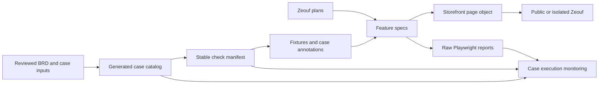

# Repository Architecture

This file is the durable, root-level architecture reference for the current Playwright TypeScript framework. Use it as the first stop when you return to this codebase in a new chat session.

For a practical walkthrough of the Zeouf suites and existing reusable functions, see the [tester guide](docs/ecommerce-tester-guide.md).

## Purpose

This repository is a code-first Playwright TypeScript framework. The Zeouf storefront is the primary target for requirement-linked browser checks, isolated frontend contracts, local production-handler checks and agent-assisted planning, generation and repair. The website lives in a separate repository and is released separately. Expand Testing, TodoMVC and Notes API tests are additional examples with their own targets and fixtures.

The current inventory contains **289 individually mapped checks for 88 of 108 cases**: **154 public-safe checks and 135 isolated checks** in `ecommerce-chromium`. The latest complete local runs passed all 289 checks with zero retries/skips/failures after the CAT-07 pagination fix. These are scoped automation links and results, not complete acceptance of 88 cases. Native website tests and manual source reviews have a separate registry and do not increase these totals. Source identity, evidence paths and historical failures are recorded in [plan 26](specs/ecommerce/26-remaining-browser-and-service-boundaries.md).

## Mental Model For A Selenium Java User

Think of the current stack like this:

- `page` is the Playwright equivalent of the browser/session object you would drive with `WebDriver`.
- `fixtures/ecommerce-base.ts` provides the zeouf storefront fixture; `fixtures/base.ts` provides the practice-site fixtures.
- `pages/ecommerce-storefront-page.ts` is the Page Object Model layer for the primary demo.
- `pages/practice-site-pages.ts` and `flows/practice-site-flows.ts` demonstrate the same separation for the practice site.
- `fixtures/test-data.ts` is the shared data layer.
- `playwright.config.ts` is the runner/config layer that defines browser projects, retries, reporting, artifacts, and base URL.

Playwright removes most of the Selenium-style driver plumbing, explicit wait helpers, and inheritance-heavy setup.

## Current File Map

### Test Layer

- [tests/ecommerce/](tests/ecommerce/) is the primary product-demo suite for the zeouf fashion storefront and the scope of the planner, generator, and healer agents.
- [specs/ecommerce/](specs/ecommerce/) contains storefront plans used by those agents.
- [tests/ecommerce/seed.spec.ts](tests/ecommerce/seed.spec.ts) is the stable browser entry point for storefront agents.
- [tests/ecommerce/catalog-boundaries-fixture.spec.ts](tests/ecommerce/catalog-boundaries-fixture.spec.ts) covers Men's tag populations, size-stock fallbacks, delayed currency changes and pagination reset through controlled GET responses.
- [tests/ecommerce/isolated/](tests/ecommerce/isolated/) covers customer/admin UI contracts with fictional identities and locally fulfilled responses. Its [service boundaries](tests/ecommerce/isolated/service-boundaries.spec.ts) call real local production handlers for malformed unsubscribe tokens and unconfigured-limiter denial.
- [tests/](tests/) also contains broader examples for the Expand Testing practice site, TodoMVC, and API scenarios. These demonstrate framework coverage beyond the storefront and are not inputs to the storefront agents.

- [tests/home.spec.ts](tests/home.spec.ts) is the homepage entry scenario that opens the inputs demo.
- [tests/demo-inputs.spec.ts](tests/demo-inputs.spec.ts) demonstrates input and reset scenarios outside the storefront.
- [tests/seed.spec.ts](tests/seed.spec.ts) is a minimal navigation seed used for tooling and quick smoke coverage.
- [tests/api/](tests/api/) contains API-only contract and CRUD scenarios.
- [tests/todo.spec.ts](tests/todo.spec.ts) exercises the separate TodoMVC page object.

### Framework Layer

- [fixtures/base.ts](fixtures/base.ts) defines the custom `test` and `expect` exports.
- [fixtures/test-data.ts](fixtures/test-data.ts) stores shared test data objects.
- [pages/practice-site-pages.ts](pages/practice-site-pages.ts) contains the small practice-site page objects.
- [pages/todo-page.ts](pages/todo-page.ts) encapsulates the external TodoMVC page.
- [flows/practice-site-flows.ts](flows/practice-site-flows.ts) contains scenario-level practice-site orchestration.
- [fixtures/api-fixtures.ts](fixtures/api-fixtures.ts) provides lazy API clients, configuration, and seed helpers.
- [fixtures/ecommerce-base.ts](fixtures/ecommerce-base.ts) provides `storefront` and automatic case annotations, browser write guards and navigation diagnostics for the storefront project.
- [fixtures/ecommerce-catalog.ts](fixtures/ecommerce-catalog.ts) supplies fictional products, size stock, response faults and controlled catalog GETs.
- [fixtures/ecommerce-browser-cart.ts](fixtures/ecommerce-browser-cart.ts) supplies browser-local cart data, storage faults and deterministic currency responses.
- [fixtures/ecommerce-isolated.ts](fixtures/ecommerce-isolated.ts) and [ecommerce-isolated-admin.ts](fixtures/ecommerce-isolated-admin.ts) extend the base for fictional customer/admin sessions and controlled service responses. Request `shop` or `admin` to activate them; import alone does not install their setup.
- [pages/ecommerce-storefront-page.ts](pages/ecommerce-storefront-page.ts) owns storefront locators and actions.

### Runtime / Config Layer

- [playwright.config.ts](playwright.config.ts) controls test discovery, parallelism, retries, reporters, output artifacts, base URL, and browser projects.
- [playwright-report/](playwright-report/) contains HTML report output.
- [test-results/](test-results/) contains runtime artifacts such as traces, screenshots, videos, and JUnit output.
- [utils/ecommerce-staging.ts](utils/ecommerce-staging.ts) checks staging configuration; it cannot establish actual database isolation.
- [utils/ecommerce-navigation-diagnostics.ts](utils/ecommerce-navigation-diagnostics.ts) observes script, document and data-request loading without intercepting requests.
- [scripts/ecommerce-repair/runtime.js](scripts/ecommerce-repair/runtime.js) shares process execution, filtered environments, disposable checkouts, builds and local server utilities across runners.

## Current Execution Flow

The primary zeouf workflow is:

1. A storefront spec imports its `test` from the base or specialized storefront fixture, and `expect` from `fixtures/ecommerce-base.ts`.
2. The fixture provides an `EcommerceStorefrontPage`, activates requested service fixtures, annotates exact case/check mappings and installs guards and diagnostics.
3. The page object owns storefront locators and actions; the spec expresses behavior and assertions.
4. Playwright records JSON/HTML/Allure results and retains trace, screenshot and video on failure. CI additionally writes JUnit.
5. The planner uses `tests/ecommerce/seed.spec.ts` to explore Zeouf and writes plans under `specs/ecommerce/`. The generator creates tests under `tests/ecommerce/`. The healer diagnoses failures in the `ecommerce-chromium` project and verifies code repairs.

The separate practice-site example also uses a flow object above its page objects for multi-step scenarios.

That means this repo uses a clean separation of responsibilities:

- Spec = scenario intent
- Flow = business-step orchestration
- Page object = UI interaction details
- Fixture = dependency injection and setup
- Config = runtime behavior

## Execution Environments

| Layer                                | Entry point                                                                                 | What its evidence establishes                                                                                                                                                 |
| ------------------------------------ | ------------------------------------------------------------------------------------------- | ----------------------------------------------------------------------------------------------------------------------------------------------------------------------------- |
| Public-safe browser checks           | `npm run test:ecommerce:read-only -- --workers=1 --retries=0`                               | An explicit 154-check allowlist against the storefront; includes controlled catalog GETs and fictional browser storage. Browser writes are blocked and staging is forced off. |
| Public HTTP/API checks               | `npm run test:ecommerce:api`                                                                | Six read-only route/JSON contracts in `ecommerce-api`; kept separate from the 289 mapped checks.                                                                              |
| Isolated frontend and local handlers | `npm run test:ecommerce:isolated -- <clean-website-checkout> <new-evidence-directory>`      | A fresh loopback production build with placeholder services. The 135 checks cover controlled UI contracts and selected real handler denials, not live database behavior.      |
| Native website suites                | `npm run test:ecommerce:native -- <clean-pinned-website-checkout> <new-evidence-directory>` | The pinned website's own docs, in-memory PostgreSQL, UI, catalog and public smoke suites. The previously verified 86 native checks remain separate evidence.                  |
| Staging integration                  | Confirmed separate HTTPS deployment, database, identities, inbox and cleanup                | Required for real ownership, transactions, concurrency, RLS, delivery and valid admin writes; no staging environment is currently supplied.                                   |

The isolated runner clones committed website source, rejects environment files, filters inherited credentials, builds with placeholder services and verifies unchanged protected framework inputs. Its local handler tests use `APIRequestContext`, which bypasses browser route mocks; the loopback fixture gate and credential-free build are therefore required. The native runner additionally parses complete TAP totals and compares browser discovery with execution. Both retain stage logs and reject skips, retries or incomplete evidence.

The framework's ordinary browser examples cover Chromium, Firefox and WebKit; the Zeouf project is Chromium. Mobile checks use viewports or emulated touch contexts, not physical devices. Hero timing checks use Playwright's browser clock while preserving visible UI assertions.

## Requirement And Evidence Flow

- [specs/ecommerce/requirements/](specs/ecommerce/requirements/) holds copied source documents, reviewed requirement overlays, case designs and automation links. `case-links.json` records case-level scope; `check-links.json` binds stable IDs to exact test titles/files/projects.
- `npm run cases:zeouf:catalog` regenerates `case-catalog.json` and `CASE_CATALOG.md`. `npm run cases:zeouf:backlog` regenerates the remaining-work view. Edit their inputs rather than generated output.
- `npm run cases:zeouf:mappings` discovers executable checks and rejects missing/ambiguous selectors or conflicting IDs. Mapping is distinct from execution and full acceptance.
- `npm run monitor:ecommerce -- <report.json> [more-reports.json]` validates case/manifest hashes, test identities and observed outcomes, then writes JSON/Markdown evidence. Skips, retry passes, expected failures, missing tests and failures stay distinct. Cases retain `acceptance: not-assessed`.
- Catalog/manifest changes change report fingerprints. Preserve old reports with their original inventory and generate new evidence for the updated inventory; never edit raw report identities or hashes. A focused passing recheck does not rewrite an earlier complete-run failure.

Reports include origin, environment, inventory hashes and source/deployment identity when supplied. A run against the public alias with an unknown website revision is not proof for an immutable build. `scripts/ecommerce-repair/deployment.js` binds a successful GitHub/Vercel deployment record to its health probe and report metadata; protected deployment access remains a separate environment requirement.

## Diagnosis And Repair

The planner/generator/healer profiles in `.github/agents/` and `.codex/agents/` remain scoped to Zeouf, its seed and `ecommerce-chromium`. Browser-tool availability depends on the agent host. Existing CLI-driven tests remain executable without claiming a tool-generated exploration log.

The [repair orchestrator](docs/ecommerce-auto-repair.md) is separate from ordinary test execution. It prepares failure packets, grounds diagnosis in requirements and observed evidence, separates website defects from permitted test repairs, builds disposable candidates and requires independent regression verification before a reviewable proposal can be published. Stable assertions, inventories and source/deployment identity are part of the verification boundary. Automatic proposals and publication require explicit repository opt-ins; no automatic merge or deployment is configured.

The [controlled repair rehearsal](docs/ecommerce-repair-evaluation.md) injects predefined faults and validates the evaluator. It is a separate demonstration, not a measurement of autonomous repair accuracy. Runtime tests do not rewrite their own locators.

## Important Conventions

- New specs should import `test` and `expect` from the fixture for their project: [fixtures/ecommerce-base.ts](fixtures/ecommerce-base.ts) for Zeouf, [fixtures/api-fixtures.ts](fixtures/api-fixtures.ts) for API tests, or [fixtures/base.ts](fixtures/base.ts) for practice-site examples.
- Page locators belong in page objects, not in specs.
- Use a flow when multi-step scenario orchestration is reused; the storefront currently uses its page object directly.
- Shared values belong in the relevant fixture or data module; Zeouf catalog/cart/customer/admin helpers are separate from the practice-site `fixtures/test-data.ts`.
- Specs should stay readable and focus on behavior, not implementation details.
- Keep the framework lean; add structure only when it pays for itself.

## Playwright Configuration Snapshot

Current config posture in [playwright.config.ts](playwright.config.ts):

- `testDir` is scoped to `./tests`.
- `testMatch` includes `*.spec.ts` and `*.test.ts` files.
- `fullyParallel` is enabled.
- `forbidOnly` is enabled on CI.
- Retries are enabled on CI only.
- CI workers are limited to 1.
- Reporters include HTML, JSON and Allure locally, plus JUnit on CI. Environment variables can select separate output paths per batch.
- Failure evidence is retained via trace, screenshot, and video.
- The global practice-site `baseURL` defaults to `https://practice.expandtesting.com`; Zeouf projects override it with `ECOMMERCE_BASE_URL` and the storefront default.
- `expect.timeout` is set explicitly to 5000 ms.
- Browser projects run Chromium, Firefox, and WebKit.
- The `api` project owns practice API specs; `ecommerce-api` owns storefront API specs. Practice browser projects exclude both API and ecommerce specs.
- The `ecommerce-chromium` project runs storefront browser specs under `tests/ecommerce/` against `ECOMMERCE_BASE_URL` (default `https://zeouf-luxury-fashion-ecommerce.vercel.app`). The `ecommerce-api` project owns storefront API specs. Specialized isolated and repair suites require their dedicated runners.
- Ecommerce specs are organized by feature and tagged `@smoke`, `@happy`, `@negative`, and `@regression` for purpose-based runs.
- Public ecommerce scenarios cover pages, guest restrictions and controlled frontend fixtures. Isolated customer/admin checks use dedicated loopback fixtures; write-capable staging scenarios remain configuration-gated.
- `BASE_URL`, `API_BASE_URL`, and `HTTP_BASE_URL` can override local defaults.

## What The Production Architecture Screenshots Influenced

The screenshots in the `production architecture/` folder were treated as a reference, not a blueprint. The useful ideas that were adopted are:

- A flow layer above the page object.
- Clear separation between scenario orchestration and low-level UI interaction.
- A stronger mental distinction between test layer, framework layer, runtime layer, and the AUT.
- More explicit mapping between test data, page objects, and runner config.

The things not copied blindly are:

- A large `src/` tree.
- Heavy module-per-feature duplication.
- Extra shared base abstractions that do not yet earn their maintenance cost.
- Enterprise-style layering that would make a tiny suite harder to navigate.

## How To Study This Repo Quickly In A New Chat

If you need to re-learn the codebase fast, read files in this order:

1. [ARCHITECTURE.md](ARCHITECTURE.md)
2. [playwright.config.ts](playwright.config.ts)
3. [fixtures/ecommerce-base.ts](fixtures/ecommerce-base.ts)
4. [pages/ecommerce-storefront-page.ts](pages/ecommerce-storefront-page.ts)
5. [tests/ecommerce/seed.spec.ts](tests/ecommerce/seed.spec.ts)
6. [tests/ecommerce/catalog.spec.ts](tests/ecommerce/catalog.spec.ts)
7. [specs/ecommerce/01-storefront-discovery.md](specs/ecommerce/01-storefront-discovery.md)

Read the practice-site fixtures, flows, and specs afterward to see additional scenario patterns.

## Known Boundaries

- This is a Zeouf-focused framework and supervised pilot, with application onboarding, tester workspace and broader product capabilities remaining on the roadmap.
- Twenty cases have no browser mapping; five have separate native/manual evidence. Seventeen cases still require staging or scope decisions for full acceptance, including unfinished backend portions of already mapped cases.
- The storefront page object and isolated service fixtures span multiple features. Reuse their existing helpers and extract feature modules when further changes justify the split.
- Healing is agent-assisted: the healer investigates a failing storefront test and can propose or apply a code repair, then verify it. Tests do not autonomously rewrite locators or recover during runtime.
- The repo is optimized for clarity and maintainability before scale.

## Validation And Release Evidence

Run `npm run check` for formatting, lint, TypeScript, static analysis, mapping validation and the 48 script regressions. Run relevant storefront suites separately; the quality gate alone does not execute all browser tests. Run Markdown formatting and link checks for documentation changes as described in [CONTRIBUTING.md](CONTRIBUTING.md).

The successful [Playwright CI run](https://github.com/varunsidr/playwright-ai-self-healing-framework/actions/runs/39836915057) and [quality-gate run](https://github.com/varunsidr/playwright-ai-self-healing-framework/actions/runs/39836914886) verified committed framework revision `2be4a094cace7a7665fa422026209401cb2ea921` on 23 October 2026 IST. Deployment pinning and staging were skipped in that run. Later local evidence covers the working tree; a new pushed commit requires its own CI result. Native/repair workflow installation and publication are separate from these successful ordinary test steps.

Use [plan 26](specs/ecommerce/26-remaining-browser-and-service-boundaries.md) for the latest complete-run and pagination-fix evidence, [automation status](specs/ecommerce/requirements/AUTOMATION_STATUS.md) for current inventory and dated history, and the [monitoring guide](docs/ecommerce-ci-monitoring.md) for report semantics. Raw reports and disposable website sources remain Git-ignored.

## Update Rule

If you change the framework shape, update this file first or alongside the change. This file should stay current enough that a future chat can use it as the shortest path back into the codebase.

## Related Roadmap

See [roadmap/FUTURE_ENHANCEMENTS.md](roadmap/FUTURE_ENHANCEMENTS.md) for planned improvements, likely next steps, and the rule for deciding whether a new abstraction is worth adding.
